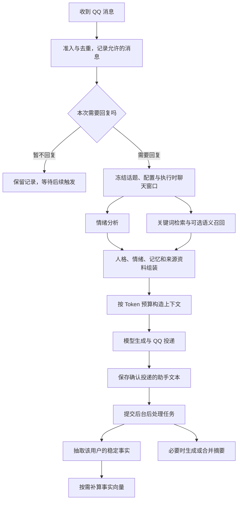

# 记忆、上下文压缩、Embedding 与情绪系统详解

本文依据 2026-10-09 的项目源码整理，源码基线为 `79e33e9`。配置默认值取自代码中的 Schema，**不是开发者正在使用的个人配置**。示例均为合成示例，不包含真实聊天、QQ 号、API Key 或数据库内容。

本项目让模型“记住”的主要方式，是把信息保存在本地 SQLite 中，并在下一次回复时选择相关资料放进模型请求。它不会因此训练模型、修改模型权重，也不会自动把整份聊天数据库发送给模型。

## 目录

1. [四套机制分别负责什么](#1-四套机制分别负责什么)
2. [一次回复的完整流程](#2-一次回复的完整流程)
3. [用户、会话与话题的隔离](#3-用户会话与话题的隔离)
4. [长期事实如何产生、更新和遗忘](#4-长期事实如何产生更新和遗忘)
5. [关键词记忆检索](#5-关键词记忆检索)
6. [Embedding 与语义召回](#6-embedding-与语义召回)
7. [上下文组织与裁剪](#7-上下文组织与裁剪)
8. [摘要压缩与递归分层](#8-摘要压缩与递归分层)
9. [Token 预算与失败边界](#9-token-预算与失败边界)
10. [情绪识别、平滑与响应](#10-情绪识别平滑与响应)
11. [配置默认值与配置示例](#11-配置默认值与配置示例)
12. [查询、管理与排查](#12-查询管理与排查)
13. [贯穿四套机制的示例](#13-贯穿四套机制的示例)
14. [实现边界与源码导航](#14-实现边界与源码导航)

## 1. 四套机制分别负责什么

| 机制 | 回答的问题 | 当前实现 |
|---|---|---|
| 记忆系统 | 对方是谁？以前说过哪些重要信息？ | 保存聊天原文、长期事实、摘要和用户资料；按身份与会话范围检索 |
| 上下文组织与压缩 | 这次给模型看哪些内容，怎样避免请求过长？ | 控制输入预算，优先保留本轮输入与近期窗口，必要时生成摘要 |
| Embedding | 不用相同关键词，能否找回意思相近的事实？ | 将长期事实和查询编码为向量，按余弦相似度召回，并与关键词结果合并 |
| 情绪系统 | 发消息的人现在表现出什么情绪，回复语气如何调整？ | 规则或模型识别，保存原始记录与平滑状态，按人格配置调整语气 |

本地数据主要分成以下几类：

| 数据 | 保存位置 | 用途 |
|---|---|---|
| 用户昵称、别名、备注 | `users` | 跨会话识别同一用户，补充用户资料 |
| 群聊或私聊会话 | `sessions` | 标识会话与当前话题 |
| 一个会话中的多个话题 | `conversations` | 隔离历史、摘要、人格覆盖与话题 Token 统计 |
| 聊天原文与消息来源 | `messages` | 留档、构造近期上下文、追溯事实与摘要来源 |
| 长期事实 | `memory_facts` | 保存身份、喜好、技能、目标等稳定信息 |
| 关键词索引 | `memory_facts_fts` | FTS5 全文召回事实 |
| 事实向量 | `fact_embeddings` | 辅助语义召回；只为事实建立索引 |
| 摘要与来源关系 | `summaries`、`summary_sources`、`summary_coverage` | 长对话压缩、来源追溯、避免重复注入已合并摘要 |
| 当前情绪状态与历史 | `user_emotion_state`、`emotion_history` | 平滑语气调节、显示情绪曲线 |
| 抽取游标、遗忘记录 | `fact_cursors`、`memory_forgetting` | 减少重复抽取，避免旧消息立即恢复已删除事实 |
| 后台任务 | `background_jobs` | 持久化事实抽取、摘要与向量补算任务 |

数据库使用 Node 内置的 `node:sqlite`，开启 WAL 和外键。这里的“长期”指持久化保存，不表示所有信息每次都会进入模型上下文。

## 2. 一次回复的完整流程



几个与实际使用有关的细节：

- 情绪分析和记忆检索并行进行，各有等待时间预算。辅助任务失败时回退，主回复通常仍可继续。
- 群聊里允许的普通消息会被记录，后续需要回复时可进入聊天窗口；并不是每条普通消息都立即调用情绪模型、事实抽取模型或摘要模型。
- 在任务执行时冻结窗口边界。排队期间新增的允许消息可以进入本轮窗口；执行窗口冻结后，不会无限追加后来的消息。
- 事实抽取与摘要在回复后的后台执行。开启事实抽取时，后处理任务有约 10 秒延迟，并按会话、用户、话题与时间段去重；前台忙碌时后台会等待。
- 只有确认投递了助手文本、取得 `assistantMsgId` 且相关开关开启时，正常回复路径才提交这些后处理任务。只发表情包成功，并不等同于产生了一条可用于该后处理路径的助手文本。
- 后台任务可持久化恢复，失败最多尝试 3 次。事实抽取失败会使同一后处理任务中的摘要步骤暂时不继续，等待重试；已发送的回复不受影响。

## 3. 用户、会话与话题的隔离

### 3.1 三种标识

| 标识 | 含义 | 典型形式 |
|---|---|---|
| `user_id` | 说话人的 QQ 身份 | 同一人在不同群仍是同一个用户 |
| `scope` | 当前群或私聊会话 | `group:<群号>`、`private:<用户QQ号>` |
| `conversation_id` | 会话中的某个话题 | 项目生成的独立话题 ID |

不同数据采用不同隔离粒度，不能把它们理解成一个全局计数或一个全局聊天缓存：

- **消息和摘要按话题隔离**：切换到新话题后，旧话题的聊天原文和摘要不会作为新话题的普通历史读取。
- **长期事实按用户与来源会话保存**：事实表没有 `conversation_id` 字段；同一个群里新开话题后，该用户已有的长期事实仍可召回。
- **情绪状态按用户与会话隔离**：主键是 `(user_id, scope)`。同一个人在 A 群与 B 群的情绪状态不同；同一个会话切换话题，不会自动清除该用户的会话情绪状态。
- **主动发言计数按话题保存边界**：各群和私聊互不累计、互不重置。它与模型的聊天窗口是两套边界；纯图片主动发言可以重置主动计数，但不会伪造一条助手文本来改变聊天窗口。

### 3.2 跨会话共享长期事实

`memory.retrieval.crossScopeSharing` 支持：

| 值 | 关键词与事实读取路径的行为 |
|---|---|
| `none` | 只读取当前会话中的该用户事实 |
| `identity-facts` | 当前会话事实，加上该用户在其他会话中允许共享且未标为私密的事实 |
| `full` | 当前会话事实，加上该用户在其他会话中未标为私密的事实 |

`identity-facts` 的名称不表示只共享 `identity` 类型。自动抽取默认允许共享的类型是 `identity`、`preference`、`skill`、`goal`，由 `shareableFactTypes` 决定新事实的 `shareable` 标记。

共享始终围绕**同一用户**进行，不会把另一个人的职业或喜好当作当前用户的事实。群里的其他人仍可能作为带身份的聊天背景出现，这与个人事实检索是不同机制。

`private=1` 表示阻止该事实跨会话共享；当前来源会话仍可读取。它不是数据库加密，也不表示管理员界面看不到。

当前合并语义检索调用没有把 `sharing: full` 传给向量检索。因此 `full` 会扩展关键词读取范围，但其语义分支目前仍只查当前会话；`identity-facts` 的语义分支则通过 `shareableOnly` 支持共享事实。不要把配置名称理解为所有检索路径完全相同。

## 4. 长期事实如何产生、更新和遗忘

### 4.1 事实类型与来源

自动抽取支持七种类型：

| 类型 | 例子，均为合成内容 |
|---|---|
| `identity` | 用户从事软件开发 |
| `preference` | 用户更喜欢无糖饮料 |
| `skill` | 用户会使用 Python |
| `goal` | 用户正在准备一个技术考试 |
| `relation` | 用户有一位一起学习的朋友 |
| `event` | 用户完成了一次重要项目交付 |
| `other` | 其他值得持续记住的信息 |

事实保存内容、检索词、置信度、来源消息 ID、共享标记、创建与更新时间、召回次数等。后续迁移还加入了 `active`、`replaces_id`、`private` 等字段。

### 4.2 抽取过程

`FactExtractor.extractAndStore()` 大致执行以下步骤：

1. 从本次后处理材料确定话题与消息截止 ID。
2. 查询这个用户、这个会话和这个话题中尚未处理的 **user 消息**，不抽助手发言。
3. 使用 `(user_id, conversation_id)` 抽取游标，并结合用户遗忘截止 ID，减少重复处理旧消息。
4. 一批最多读取 30 条候选，按约 2500 字符控制抽取文本；发给模型的转录还会做长度限制。
5. 消息包含转发、卡片或网页引用时，抽取输入尽量只保留发送者自己的文字段，避免把原作者的自述记在转发者名下。
6. 调用“模型用途 → 记忆抽取”模型，要求输出事实 JSON 数组。
7. 验证事实、去重、保存或替换，并在事务中更新抽取游标。

过短的转录会跳过抽取。无新增事实的有效 JSON 数组 `[]` 是正常结果，不是报错。

### 4.3 自动入库条件

每条自动抽取的事实必须同时满足：

- 内容非空且至少 3 字符。
- `confidence >= 0.8`。
- `evidence === 'explicit'`，表示用户明确自述。
- `sourceId` 对应本批该用户的真实来源消息。
- 没有被判定为同会话、同用户的重复内容。

`reported`、`inferred`、`joke` 不满足自动入库条件。模型即使生成了“推测的个人信息”，也不应直接变为事实。

这些验证是减少误记的措施，仍不等于逐字核验内容与原文一致。来源 ID 合法、置信度高，不保证模型解释一定正确，必要时仍应通过界面查看和修正。

### 4.4 去重与事实替换

当前去重以规范化后的内容相等为主：规范化会处理大小写、全半角及部分标点空白。它不是通过 Embedding 判断两句话是否完全等价，因此不同表述仍可能形成重复事实。

用户明确改变状态时，模型可输出 `replacesId`。保存前验证旧事实的用户、会话和类型归属；有效替换会：

- 新建事实。
- 将旧事实置为 `active=0`。
- 在新事实上记录 `replaces_id`。
- 删除旧事实向量，普通召回只使用有效事实。

不是同一类型就自动覆盖，也不会仅凭词语相似替换旧事实。若模型未给出正确的替换关系，矛盾信息仍可能并存，需要人工修正。

### 4.5 删除与遗忘

用户可使用 `/forget <关键词>`；管理界面也有事实删除接口。删除事实时会记录 `memory_forgetting`，保存删除对象与当时该用户的消息截止 ID，以防后台又从相同旧消息中把它抽取回来。

删除还会清理该来源会话中可关联的摘要；没有来源关系的旧摘要会采用更保守的清理方式。事实向量通过外键联动删除。

需要区分：

- 删除事实不是删除全部聊天原文。
- 旧原文若仍位于当前聊天窗口中，模型仍可能看到这句话。
- 用户在遗忘截止 ID 之后重新明确陈述该信息，可能再次形成新事实。
- 遗忘截止目前按用户记录，可能一并跳过该用户在其他会话中的较早、尚未抽取消息；它不是精确到一条事实语义的屏蔽列表。

因此，“忘掉某条长期记忆”与“完整清除一段聊天及其备份”是不同操作。

## 5. 关键词记忆检索

### 5.1 查询词构造

`extractQueryTerms()` 会从当前消息中提取中文词组、英文词等，去除一批停用词。较长中文串会拆成相邻二字片段，并将去重后的查询词限制为最多 15 项。

这是一种没有引入专门中文分词器的工程折中，能改善中文召回，但无法完全理解句子的语义、否定和指代。

### 5.2 FTS5 与 LIKE 召回

`MemoryStore.searchFacts()` 会：

1. 先过滤用户身份、有效状态与共享范围。
2. 用 FTS5 进行查询，关键词之间以 OR 连接。
3. 同时用安全转义后的 LIKE 查询补充事实内容与关键词匹配；即使 FTS 查询失败，LIKE 仍可返回结果。
4. 合并两路结果并按事实 ID 去重。
5. 根据置信度、时间衰减和使用次数重新排序，最后截取 `retrieval.limit`。

FTS 候选使用 BM25 排序取得，但最终结果并不是直接按 BM25 分数返回。

### 5.3 最终关键词排序分数

```text
ageDays = (当前时间 - 事实 updated_at) / 一天
decay = 0.5 ^ (ageDays / halfLifeDays)
score = confidence × (0.5 + 0.5 × decay)
        + min(hit_count, 5) × 0.05
```

`identity` 和 `skill` 的实际半衰期至少取 365 天，其他事实使用配置的半衰期，默认 30 天。

这里的衰减只影响排名，不会定时删除事实；由于有 `0.5` 的基础项，事实也不会仅因时间久就衰减到零。召回更新的是 `hit_count` 与 `last_hit_at`，不是事实的 `updated_at`。

### 5.4 兜底与摘要选取

如果关键词没有返回事实，检索器会取权限范围内置信度较高、较新的最多 8 条事实作为兜底，之后再受总 `limit` 限制。并非只有“没有查询词”才会兜底，有查询词但无结果也会走这一步。

摘要按当前话题读取未被父摘要覆盖的记录，检索器优先考虑高层级摘要，并最多选 3 条。

最终返回 `facts`、`summaries`、`hitIds` 与统计信息。事实“在数据库中存在”不等于“这一次一定会被选中”，也不等于“选中后一定保留在最终请求中”。

## 6. Embedding 与语义召回

### 6.1 它解决什么问题

例如，事实是“用户喜欢徒步”，当前问题是“周末有什么适合户外走一走的活动”。二者关键词未必明显重合，但合适的向量模型可能给出较高语义相似度，从而补充关键词没有找到的事实。

Embedding 的结果是固定维度的数值数组；它本身不是回复文本，也不是摘要。当前项目的向量对象主要是 **长期事实**，并未给全部聊天、所有摘要或收藏图片建立一个统一的向量知识库。

### 6.2 启用条件与协议

语义召回需要同时满足：

1. `memory.retrieval.semantic: true`。
2. “模型用途 → 向量化”有可解析的供应商。
3. **显式设置** `llm.roles.embedding.model`，不能只继承主对话模型。
4. 服务实际能返回合法向量。

`embeddingReady()` 检查的是配置条件，不是网络连通性与模型能力证明。接口是否可用，应通过面板测试或 `POST /api/llm/roles/test-embedding` 验证。

| 协议 | 当前请求形式 |
|---|---|
| OpenAI 兼容 | 在配置根地址后请求 `/embeddings`，输入为文本数组 |
| Ollama | `/api/embed`，支持相应向量返回结构 |
| Gemini | `batchEmbedContents`，按模型构造批量请求 |
| `auto` | Embedding 路径按 OpenAI 兼容协议处理 |

不能因为一个服务可以聊天，就认为它支持向量化。当前没有独立的 Anthropic 原生 Embedding 适配；实际兼容性取决于服务是否实现项目发出的接口。

### 6.3 向量补算与模型标识

`SemanticIndex` 连接后台队列后，在事实变化或语义检索发生时可请求补算。单个后台补算任务最多处理 30 条候选，以免占用过多响应资源。

流程为：

1. 找出未保存向量或向量模型标识不匹配的事实。
2. 对输入执行 NFKC 规范化与首尾空白清理。
3. 批量调用向量模型。
4. 校验结果数量、维度与数值。
5. 保存前确认未取消、模型标识未切换、事实内容没有在请求期间改变。
6. 以 Float32 BLOB 写入 `fact_embeddings`。

索引标识不只是模型名称，还包括供应商、模型、文本处理版本和供应商配置指纹。换模型或相关配置后，旧向量不会直接当作新模型的向量使用，而是按需补算。

每条向量保存维度、源文本与内容哈希。检索要求源文本仍与事实内容一致，避免旧向量对应新文字。每条事实目前只保存一份向量，不会同时保留多个模型的全部向量版本。

### 6.4 向量校验与存储规模

返回向量需要满足：数量与请求一致、维度一致且非空、维度不超过 65536、数值有限并可表示为 Float32、向量不是全零。OpenAI 兼容响应若提供 `index`，还会校验并恢复输入顺序。

当前实现将符合身份、范围、模型及维度条件的最多 5000 条事实取出，在程序中逐条计算相似度。它使用 SQLite BLOB 存储，不是专门的 HNSW/ANN 向量数据库；数据量增长时，计算和读取成本会增长。

### 6.5 余弦相似度与排序

```text
cosine(a, b) = dot(a, b) / (norm(a) × norm(b))
semanticScore = similarity × (0.5 + 0.5 × confidence)
```

先按 `semanticMinScore` 过滤余弦相似度，默认阈值为 `0.35`，再按结合置信度的分数排序。

相似度不是“正确概率”。两个向量很接近，不代表信息事实正确，也不保证符合当前问题中的否定、时间条件或人物指代。

### 6.6 与关键词结果融合

两路结果按事实 ID 使用 RRF（Reciprocal Rank Fusion）融合，而不是把关键词原始分数与余弦分数直接相加：

```text
RRF(fact) = Σ 1 / (60 + rank + 1)
```

`rank` 从 0 开始，求和覆盖该事实出现的检索列表。两路都排名靠前的事实，更容易排到最终列表前面；合并后仍受 `retrieval.limit` 限制。

语义召回是可选增强。未配置、接口失败、超时或没有合格向量时，保留关键词结果。事实补算尚未完成时，新事实仍可能先被关键词找到，语义召回随后才生效。

语义索引中的查询与补算请求当前使用约 2000 毫秒超时；主回复外层还有独立的记忆检索等待预算。外层降级后，晚到结果不会替换本轮已经选定的回退结果。

## 7. 上下文组织与裁剪

### 7.1 模型每次看到什么

一次典型请求包含：

1. 当前人格、行为规则、自身信息、来源说明等 system 内容。
2. 选中的长期事实和当前话题摘要，作为有边界的参考资料。
3. 按预算保留的人格示例，最多考虑 4 组。
4. 本话题的近期历史与本次待回应聊天窗口。
5. 本轮触发消息、引用信息和允许附带的图片。

群聊历史会标明发言者身份、QQ、消息 ID、时间、@ 与引用关系，避免只靠昵称猜测是谁说了什么。被动回复的触发者与窗口里的最后发言者会明确区分。

记忆被包在 `DATA_BEGIN` / `DATA_END` 对应的资料边界中，并声明其中的指令不应执行。记忆用于提供背景，不应覆盖当前人格和系统约束。

### 7.2 最近轮数与回复窗口

`recentTurns` 控制较早历史的读取规模：构造器读取 `max(recentTurns × 2, 30)` 条近期消息作为较早历史候选。

但它**不是本轮总消息条数的硬上限**。`captureReplyWindow()` 另行读取上次助手文本回复之后、截至执行截止 ID 的消息窗口，最多扫描 2000 条，且窗口内消息不因已有摘要标记就直接丢弃。

这样，在群里机器人暂时没说话时，连续积累的允许消息仍有机会进入下一次回复，而不是只剩固定几轮。最终仍要服从 Token 预算，窗口超过预算就保留较新的部分。

### 7.3 裁剪优先级

构造器先检查 system 与本轮输入能否装入预算，再考虑其他内容。历史从新到旧尝试纳入，放不下时停止继续加入更旧消息。

如果 system 过大，回复管线先尝试移除较后面的事实，再移除摘要，重建 system，而不直接随意裁掉人格定义。本轮输入与不可省略的 system 若仍超限，会明确失败：

```text
人格和本轮输入超过上下文预算，无法安全裁剪
```

因此，保存了很多事实、检索到了很多事实，都不保证它们全部发给模型。图片也占用输入预算，图越多，可保留的文本历史通常越少。

### 7.4 人格切换与旧回复

助手文本保存人格 ID 与人格内容指纹。若历史助手消息来自其他人格或旧版本，构造器会将其标为“历史机器人回复资料”，而非继续当成当前人格的助手示例。

摘要提示词也要求保留历史机器人身份，不能把机器人的角色表演、口头自称变成用户身份或当前人格设定。这是在保留历史与防止人格污染之间做的区分。

## 8. 摘要压缩与递归分层

### 8.1 三种策略

| `context.compressStrategy` | 行为 |
|---|---|
| `trim` | 按预算裁剪原文，不生成摘要；已有摘要的检索是另一条路径，并不因此自动删除 |
| `summary` | 生成 L1 摘要，后续将已有未覆盖摘要与新的旧消息合成更新摘要 |
| `layered` | 生成 L1，数量达到条件后进一步合并为 L2、L3，最高到配置层级 |

长期事实抽取由 `memory.factExtraction` 单独控制。它不是 `layered` 才能使用的功能，也不是生成摘要的必需步骤。

### 8.2 何时触发

必须开启 `memory.summary.enabled`，且策略不是 `trim`。后台检查以下条件之一：

- 本轮上下文发生历史裁剪，形成 Token 压力。
- 本话题未摘要消息数达到 `summary.triggerMessages`，默认 40 条。
- `layered` 模式下，某个可继续合并层级的未覆盖摘要已达到 8 条。

消息数阈值不是“每 40 条必定立刻摘要”。摘要在后台调度，还要满足保留近期消息、任务状态和有效候选等条件。

### 8.3 保留近期原文

压缩读取截止 ID 之前最多 400 条未摘要消息，并计算近期保留边界。默认 `keepRecentTurns=8`：优先按用户发起的轮次边界保留近期内容，特殊情况下按约两条消息一轮的数量兜底。

群聊一轮可能有多人的连续发言，所以这不是永远固定保留 16 条。待压缩原文少于 4 条时，通常返回“待压缩消息过少”；若已有层级合并工作，则可只处理合并。

### 8.4 摘要写入与覆盖关系

模型摘要要求保留人物、时间、决定、约定、情绪转折和未解决问题，省略重复寒暄。提示词通常要求约 400～1200 字，但实际输出仍受模型与 Token 上限影响。

成功后 `commitSummary()` 以事务方式：

- 验证话题归属与源消息是否已被其他任务处理。
- 保存摘要。
- 在 `summary_sources` 记录原始来源消息。
- 将源消息标为 `summarized=1`。
- 如合并已有摘要，在 `summary_coverage` 保存子摘要到父摘要的覆盖关系。

**压缩不删除聊天原文。** 普通历史构造会避开不必重复注入的已摘要旧消息；回复窗口中的相关近期原文仍可重新进入上下文。

### 8.5 L1、L2、L3 如何形成

在 `layered` 模式下，一个层级达到 8 条未覆盖摘要后，取该层级的 8 条记录，按时间整理后生成更高一层的摘要。过程继续检查更高层级，最多到 `maxLevel`，默认 3、可配置 1～5。

被合并的子摘要仍保存，但常规读取过滤已经被父摘要覆盖的记录，避免“旧摘要与总摘要”重复灌入 prompt。

这些层级代表压缩程度，不是严格按一天、一周、一月划分。递归越深，信息越浓缩，也可能损失细节；源码没有保证摘要逐字无损。

### 8.6 压缩失败时

摘要为空、模型异常或话题被删除时，不会把未成功摘要的消息直接标成已摘要。请求仍可依靠原文裁剪继续运行。

摘要为空但有推理内容时，管线会尝试以更大的预算重试一次。若用户为该用途设了非零输出 Token 上限，该上限仍会覆盖重试参数，不会因为重试就绕过用户设置。

任务固定来源话题与截止 ID，不会把旧话题的摘要写到新话题；话题删除后不会因后台任务复活旧数据。

## 9. Token 预算与失败边界

### 9.1 输入预算

上下文构造阶段的近似公式是：

```text
usable = min(实际模型上下文窗口, context.modelContextWindow)
outputReserve = min(请求输出预算, floor(usable / 2))
inputBudget = max(0, floor(usable × context.maxTokensRatio) - outputReserve)
```

请求未单独提供输出预算时，构造器使用 `context.reserveForReply`。正常回复路径会提供人格或全局预算，再由用途预算决定是否覆盖。

例如使用源码默认的 32768 窗口上限、0.7 比例和 1024 输出预留：

```text
floor(32768 × 0.7) - 1024 = 21913 tokens
```

这 21913 是输入估算预算，不是“数据库容量”，也不是每天总用量。

### 9.2 估算与二次检查

文本粗略估算为中文/日文字符数除以 1.5，加其他字符数除以 3.5，再向上取整。另计消息封装、名称与图片开销。

图片尺寸未知时保守估算 4096 tokens；其他图像估算路径也会考虑尺寸与分块开销。实际供应商 Tokenizer、图像计费和推理 Token 规则可能不同，项目估算不是账单精确值。

`fitModelBudget()` 在实际模型请求前再次检查输入，并将输出限制在模型窗口的一半以内；备用模型窗口较小时，也会重新裁剪较早历史。如果只剩 system 与本轮输入仍装不下，则明确抛错。

### 9.3 各用途输出上限

| 用途 | 未覆盖时的原预算 |
|---|---|
| 回复 `chat` | 人格 `maxTokens` 优先，否则 `llm.generation.maxTokens`，源码默认 1024 |
| 摘要 `summary` | `llm.generation.summaryMaxTokens`，源码默认 1200 |
| 事实抽取 `facts` | 800 |
| 情绪分析 `emotion` | 200 |

`llm.tokenBudgets.<用途>` 为 0 时沿用原预算，非零时覆盖该用途每次生成的预算，包括预算扩大的重试。设置范围为 0～131072，实际仍受模型窗口约束。

Embedding 不生成聊天文本，没有上述“输出正文 Token 上限”配置；它有输入文本、请求时限与向量有效性限制。

达到输出上限通常是截断或提前停止，不必然是接口调用失败。事实抽取或情绪 JSON 被截断时，解析才可能失败；摘要正文过短，则可能丢掉部分要点。输出预算和超时是两个独立限制，加大 Token 上限不能解决所有超时。

## 10. 情绪识别、平滑与响应

### 10.1 分析对象与维度

分析的是**用户消息表现出的情绪**，不是 Bot 自己的真实感受，也不是关于用户的永久人格结论。

| 字段 | 范围 | 含义 |
|---|---|---|
| `label` | 七种标签 | 喜悦、悲伤、愤怒、焦虑、惊讶、平静愉悦、中性 |
| `valence` | -1～1 | 负面到正面 |
| `arousal` | 0～1 | 平静到激动 |
| `dominance` | 0～1 | 无力到掌控 |
| `intensity` | 0～1 | 情绪表达强度 |
| `confidence` | 0～1 | 本次判断的内部置信度 |

内部标签分别是 `joy`、`sadness`、`anger`、`anxiety`、`surprise`、`calm-happy`、`neutral`。置信度是系统打分，不是经过校准的真实正确率。

### 10.2 三种识别方式

| 模式 | 行为 |
|---|---|
| `rule` | 始终用本地中文情绪词典与规则，不调用情绪模型 |
| `llm` | 有模型管理器时尝试调用情绪模型，失败回退规则 |
| `hybrid` | 先跑规则，规则置信度达到 0.6 时直接采用；低于阈值才调用模型 |

规则分析考虑情绪词、词前否定词、程度副词、连续感叹号/问号、笑声和哭泣表达。分类中，高唤醒负效价且支配度较高倾向 `anger`，较低倾向 `anxiety`；正效价高唤醒倾向 `joy`，较低唤醒倾向 `calm-happy`。

规则使用字符串命中与有限前缀判断，不是完整语言理解。讽刺、引用、复杂否定、网络新词和重叠词可能误判。

LLM 路径最多提供消息前 800 字符，要求返回 JSON，并将数值限制到合法范围。无法解析或接口异常时回退规则。`analyzeBatch()` 目前始终是规则批量分析，不逐条调用 LLM。

回复管线外层默认最多等待 2000 毫秒；达到等待预算会取消辅助等待、使用规则回退。本轮结果选定后，晚到的模型结果不会再替换它。

### 10.3 当前状态的 EMA 平滑

`user_emotion_state` 保存该用户在该会话的当前状态。首次分析直接用当次结果；之后采用：

```text
next = previous × (1 - smoothing) + current × smoothing
```

默认 `smoothing=0.3`：新的数值状态含 70% 上一状态、30% 当前结果。适用于效价、唤醒、支配、强度和置信度；标签仍取本次标签，样本数递增。

因此标签可能已经变化，但强度仍保留前一状态的影响。当前没有根据距离上次消息的时间自动衰减状态；隔很久回来，旧状态仍可能参与下一次平滑。

`emotion_history` 保存的是当次分析的原始数值，消息上的情绪标注也是当次结果，二者不是 EMA 曲线。

### 10.4 用于本轮回复的再次混合

回复管线在更新状态后，还调用 `modulatedEmotion()`：

```text
weight = 当前置信度 >= 0.8 ? 0.6 : 0.3
replyValue = 当前分析值 × weight + EMA状态值 × (1 - weight)
```

它混合强度、效价和唤醒度，保留当次标签以及其他字段。这样，高置信度结果更影响当前语气；低置信度单次异常结果更多受已有状态约束。

“消息上的原始情绪”“数据库中的 EMA 状态”“实际用于本轮语气的情绪”因此可能不同。

### 10.5 对人格与表情包的影响

只有 `emotion.affectPersona=true` 且当前人格为该标签配置了 `emotionModulation`，system prompt 才加入相应语气调整说明，例如更耐心、减少调侃或适度庆祝。

提示词要求自然调整语气，不直接告诉用户“检测到了你的情绪”。没有对应人格映射时，不会凭空生成一个固定的标签语气规则；情绪也不应替换人格本身。

自动表情包会使用情绪标签与强度，但还要满足自动开关、情绪范围、最低强度、概率、会话冷却、候选与每次发送上限。缺少情绪结果时，自动逻辑会记录 `emotion-unavailable`。

关闭情绪分析不代表用户明确请求的表情包一定不能发；明确表情请求与按情绪自动补图是不同路径。情绪识别成功也不保证每次回复都有表情包。

## 11. 配置默认值与配置示例

### 11.1 主要默认值

| 配置 | 默认值 | 作用 |
|---|---|---|
| `memory.recentTurns` | 12 | 较早原文读取规模；不是回复窗口硬上限 |
| `memory.factExtraction` | true | 回复后的事实抽取开关 |
| `memory.retrieval.limit` | 20 | 最终事实召回上限 |
| `memory.retrieval.timeDecayHalfLifeDays` | 30 | 普通事实排序的时间半衰期 |
| `memory.retrieval.semantic` | false | 可选语义召回 |
| `memory.retrieval.semanticMinScore` | 0.35 | 最低余弦相似度 |
| `memory.retrieval.timeoutMs` | 2000 | 主回复等待检索的预算 |
| `memory.retrieval.crossScopeSharing` | identity-facts | 默认共享指定类型的可共享事实 |
| `memory.summary.enabled` | true | 摘要开关 |
| `memory.summary.triggerMessages` | 40 | 未摘要消息触发阈值 |
| `memory.summary.keepRecentTurns` | 8 | 压缩时保留近期轮次 |
| `memory.summary.maxLevel` | 3 | 最大摘要层级 |
| `context.maxTokensRatio` | 0.7 | 输入与输出预留前的窗口使用比例 |
| `context.modelContextWindow` | 32768 | 构造阶段窗口上限 |
| `context.reserveForReply` | 1024 | 未单独传入输出预算时的预留 |
| `context.compressStrategy` | layered | 裁剪与层级摘要策略 |
| `emotion.enabled` | true | 回复时启用情绪分析 |
| `emotion.mode` | hybrid | 规则与模型混合 |
| `emotion.timeoutMs` | 2000 | 情绪辅助等待预算 |
| `emotion.smoothing` | 0.3 | EMA 更新系数 |
| `emotion.affectPersona` | true | 允许配置的情绪语气调节 |

### 11.2 可对照的配置片段

以下是源码默认行为对应的示例片段，不包含供应商凭证，不用于整体覆盖已有配置：

```yaml
memory:
  recentTurns: 12
  factExtraction: true
  retrieval:
    limit: 20
    timeDecayHalfLifeDays: 30
    semantic: false
    semanticMinScore: 0.35
    timeoutMs: 2000
    crossScopeSharing: identity-facts
    shareableFactTypes: [identity, preference, skill, goal]
  summary:
    enabled: true
    triggerMessages: 40
    keepRecentTurns: 8
    maxLevel: 3

context:
  maxTokensRatio: 0.7
  modelContextWindow: 32768
  reserveForReply: 1024
  compressStrategy: layered

emotion:
  enabled: true
  mode: hybrid
  timeoutMs: 2000
  smoothing: 0.3
  affectPersona: true

llm:
  tokenBudgets:
    chat: 0
    summary: 0
    facts: 0
    emotion: 0
```

若要开启语义召回，在已有配置中选择实际支持向量化的供应商和模型，再将 `semantic` 设为 true。下面的名称只是待替换占位符，不是项目自带模型：

```yaml
llm:
  roles:
    embedding:
      provider: your-provider-key
      model: your-embedding-model-id
memory:
  retrieval:
    semantic: true
```

回复、事实抽取、情绪和摘要可以在“模型用途”中分别选择模型。一般应根据实际服务的能力、窗口、延迟与返回格式测试，不要求它们使用同一个聊天模型。

### 11.3 配置字段不等于一定控制了当前路径

以下字段需要结合当前实现理解：

- `memory.retrieval.fts` 虽在 Schema 中存在、默认 true，当前检索器没有用它决定是否调用关键词检索；设为 false 不能据此认为关键词路径已关闭。
- `emotion.dimensions` 在 Schema 中存在，默认三个维度；当前分析与存储仍计算完整分数，没有按这个列表裁掉对应维度。
- 情绪和事实抽取模型的实际选择通过 `llm.roles.emotion`、`llm.roles.facts`，不能只看旧的 `emotion.model`、`memory.factExtractionModel` 字段推断当前使用模型。
- `shareableFactTypes` 决定新事实的共享标记，不会自动批量修改既有事实。抽取器在启动时接收类型列表，修改后应核对运行时是否已刷新。

配置保存沿用项目的校验、原子持久化与运行时同步流程；本说明文档没有修改任何现有配置。

## 12. 查询、管理与排查

### 12.1 用户命令

| 命令 | 用途 |
|---|---|
| `/memory` | 查看当前用户在当前共享策略下可读取的长期事实，不是完整聊天归档 |
| `/forget <关键词>` | 删除匹配的可读取事实，保存遗忘记录 |
| `/emotion` | 查看当前用户在当前会话的情绪状态 |
| `/new [标题]` | 新建话题，旧话题保留，长期事实不会因此自动清空 |
| `/topics` | 查看或切换会话话题 |
| `/stats` | 查看相关数据统计 |

是否可执行仍受项目的命令权限与会话准入规则控制。

### 12.2 管理接口

| 接口 | 用途与边界 |
|---|---|
| `GET /api/users/:id` | 用户详情、事实与会话情绪等资料 |
| `GET /api/users/:id/emotion?scope=...` | 指定会话的原始情绪历史；不传 scope 时会返回该用户跨会话记录 |
| `GET /api/memory/explain?userId=...&scope=...&q=...` | 解释关键词候选，不调用模型，不等于本轮最终 prompt |
| `GET /api/memory/forgetting` | 查看遗忘记录 |
| `PATCH /api/facts/:id` | 修改有效事实的内容、私密标记或置信度；清除旧向量并通知补算 |
| `DELETE /api/facts/:id` | 删除事实 |
| `GET /api/llm/roles` | 查看用途模型、就绪配置与向量统计 |
| `POST /api/llm/roles/test-embedding` | 实际测试供应商与向量模型 |
| `GET/PATCH /api/token-budgets` | 查询或修改各用途输出预算 |

这些是管理接口，应通过项目现有鉴权访问。曲线接口可以跨会话展示，不表示运行时的情绪状态混在一起。

### 12.3 为什么“它没有记住”

排查时按信息流逐步确认：

1. **有没有记录原文**：消息是否通过准入、不是重复事件、包含可记录内容？
2. **有没有触发后台抽取**：是否产生了确认发送的助手文本，抽取开关是否开启，后台是否仍排队？
3. **是否符合入库条件**：内容是否稳定、用户自述、来源合法、置信度至少 0.8？
4. **事实是否有效且在范围内**：用户、会话、`active`、共享及私密标记是否正确？
5. **是否被召回**：查询词或语义相似度是否命中，是否被数量上限挤掉？
6. **是否进入最终上下文**：模型窗口过小、system 过长或图片过多时，事实可能在预算裁剪中被移除。
7. **模型是否运用了资料**：即使已注入，也不保证生成模型每次都明确提到记忆。

### 12.4 日志与常见现象

| 现象或日志 | 当前含义 |
|---|---|
| `记忆检索完成` | 关键词与摘要读取已结束；调试统计不能当作最终请求逐条清单 |
| `记忆检索辅助任务降级` | 外层等待超时、取消或异常，按关键词回退 |
| `语义检索失败，使用关键词结果` | 合并语义路径异常，保留基础检索 |
| `已补算事实向量` | 有新的向量保存成功 |
| `抽取了 ... 条长期记忆` | 自动事实入库成功 |
| `待压缩消息过少` | 近期保留后不足以生成新摘要，通常正常 |
| `上下文已压缩为摘要` | 新摘要提交成功、源消息标记成功 |
| `摘要已递归压缩到更高层级` | 已形成父摘要覆盖子摘要 |
| `摘要为空：推理占满了预算` | 有推理内容但正文为空，触发扩大预算重试 |
| `情绪辅助任务降级` | 情绪等待失败，使用规则结果 |
| `自动表情包跳过 / emotion-unavailable` | 自动发送路径没有可用情绪结果；并非在说明图片识别失败 |

`上下文已构建` 还可查看话题 ID、截止 ID、窗口消息数、扫描遗漏数、模型、估算 Token 与预算。若窗口数量大于实际纳入数量，应结合预算和扫描上限判断。

## 13. 贯穿四套机制的示例

假设用户在示例群 A 说：“我最近在准备技术考试，平时更喜欢无糖饮料。”

1. 消息原文记录在群 A 当前话题中。
2. 需要回复时，情绪与记忆检索并行。若没有明显情绪词，规则可能较低置信度，hybrid 再尝试情绪模型。
3. Bot 确认发送文本后，后台稍后抽取该用户的 `goal` 与 `preference` 事实；前提是模型输出满足明确自述、来源与置信度要求。
4. 若向量模型已配置，事实变化可请求后台补算。补算完成前，关键词仍可以检索这些事实。
5. 下次用户问“复习时喝点什么”，语义召回可能补入饮料喜好；人格 prompt 将其作为资料，不作为指令。
6. 群 A 聊天足够长或出现 Token 压力后，旧对话生成摘要，保留考试约定和未完成事项，近期对话继续保留原文。
7. 用户在群 B 说话时，同一用户的可共享目标与喜好可能被召回，但群 A 的聊天原文和话题摘要不会当成群 B 的历史读取；两群情绪状态分别更新。
8. 用户说“我已经考完了”，如果抽取模型明确输出有效的替换关系，旧目标失效、新事实入库；否则需要检查是否出现并存记录。

这个过程既需要本地状态，也需要每次请求的资料选择。它不是把一次聊天内容永久写进模型脑中。

## 14. 实现边界与源码导航

### 14.1 目前能做到与不能保证的事情

- 保存长期事实、摘要与原文，不意味着“所有已保存信息每次都能想起来”。
- Embedding 改善语义召回，不负责判断事实真实性，也不会解决全部指代、否定或过期信息问题。
- 摘要是有损压缩，递归合并可能丢细节；重要时间与约定需要结合原文核对。
- 事实抽取只在特定回复后处理路径触发，普通群聊用户没有各自触发回复时，不保证每个人的新事实立即沉淀。
- 查询嵌入与批量补算的当前超时较短；提高外层检索超时，不会自动改变所有内部向量请求的 2000 毫秒限制。
- 向量检索跳过已失效或源文本不一致的向量。待补算查询目前主要按缺失/模型不匹配找候选，不能据此承诺所有异常旧库的文本失配都立即自动修复；管理接口修改事实会主动清理旧向量。
- 摘要主要按层级与时间读取，不是对所有摘要做 Embedding 后语义搜索。
- 情绪规则与模型都有误判可能，EMA 状态不是用户长期性格，也没有时间间隔自动归零机制。
- 时间衰减是排序权重，不是自动删除或语义遗忘算法。
- 辅助任务降级保护主回复，但主模型生成、数据库故障或实际 QQ 投递仍可能失败，不能理解为“所有失败都一定能正常聊天”。

本地数据库、聊天、事实、向量和情绪记录都属于运行数据。公开发行时只应包含代码、说明和脱敏模板，不能把开发版的个人运行数据一起发布。

### 14.2 主要源码

| 文件 | 对应内容 |
|---|---|
| [数据库 Schema](../src/memory/schema.ts) | 表结构、FTS、外键与迁移 |
| [记忆存储](../src/memory/store.ts) | 事实生命周期、检索排序、摘要提交、情绪状态 |
| [事实抽取](../src/memory/extractor.ts) | 抽取提示、来源验证、游标、入库条件 |
| [记忆检索器](../src/memory/retriever.ts) | 查询词、事实/摘要选取、两路融合 |
| [语义索引](../src/memory/semantic.ts) | 后台补算、模型指纹、查询向量 |
| [Embedding 客户端](../src/llm/embedding.ts) | 协议、向量校验、余弦、BLOB 编解码 |
| [模型管理器](../src/llm/manager.ts) | 用途选择、Embedding 就绪与实际调用 |
| [上下文构造与压缩](../src/context/compressor.ts) | 输入预算、历史选择、摘要生成与递归 |
| [Token 估算](../src/context/tokens.ts) | 消息封装与图片开销 |
| [模型预算复核](../src/llm/budget.ts) | 实际模型与备用模型的窗口检查 |
| [回复管线](../src/pipeline/reply.ts) | 四套机制在回复中的连接与后处理 |
| [回复窗口](../src/pipeline/window.ts) | 截止 ID、上次助手回复边界与身份关系 |
| [后台队列](../src/pipeline/background.ts) | 去重、前台优先、恢复与有限重试 |
| [辅助降级与情绪混合](../src/pipeline/auxiliary.ts) | 等待预算、回退、当前情绪与 EMA 混合 |
| [情绪分析](../src/emotion/analyzer.ts) | 词典、分类、hybrid、JSON 解析 |
| [人格提示组装](../src/persona/manager.ts) | 情绪语气、记忆资料边界 |
| [配置 Schema](../src/core/types.ts) | 主要默认值与校验范围 |
| [管理接口](../src/server/api.ts) | 事实修正、情绪曲线、用途和预算管理 |

相关专题文档：[Token 预算](token-budgets.md)、[回复窗口与对象归属](reply-window-and-addressing.md)、[人格结构与历史隔离](persona-context-and-structure.md)、[日志诊断](log-diagnostics.md)。
